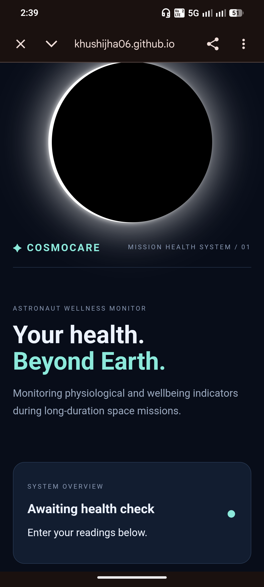
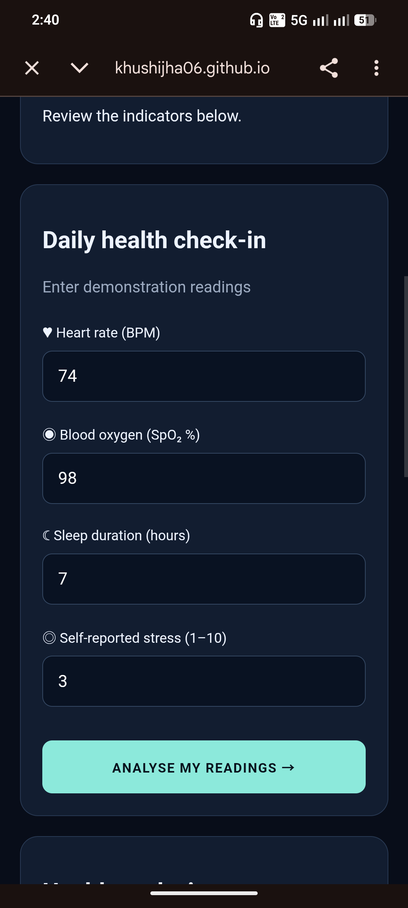
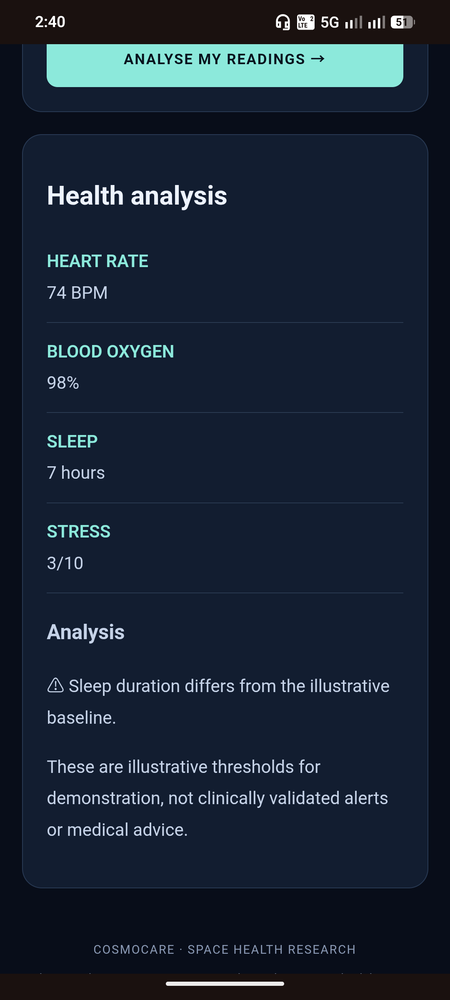

CosmoCare

Astronaut Health Monitoring System

An astronaut health-monitoring prototype for long-duration space missions.

Live Website

"Launch CosmoCare" (https://khushijha06.github.io/CosmoCare/)

Project Screenshots

### Main Dashboard

### Health Analysis

### Health Insights

Technologies Used

- HTML
- CSS
- JavaScript
- GitHub Pages

Developer

Khushi Jha
NASA Space Apps Challenge 2026 – Solo Participant
